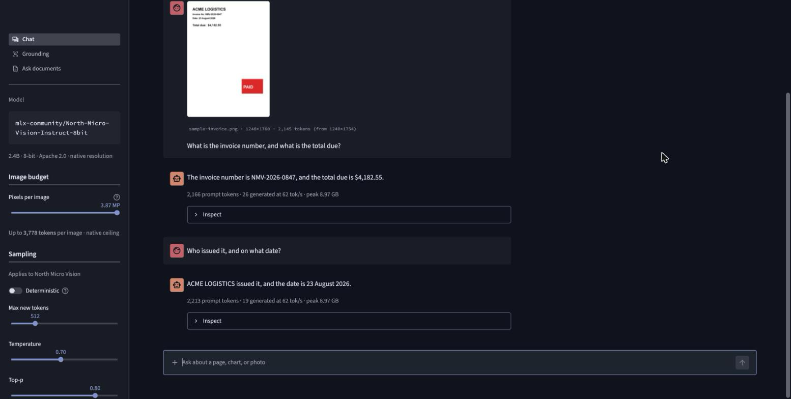
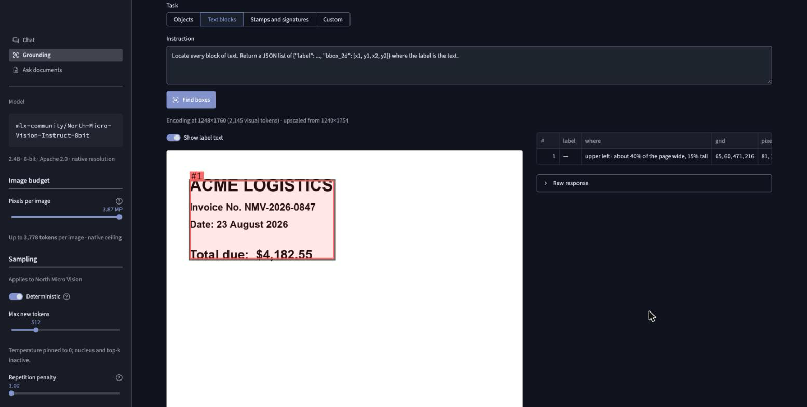
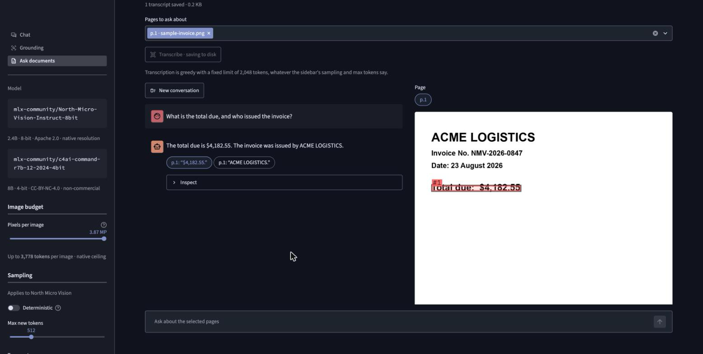

# Cohere Document Intelligence

[](https://github.com/darylalim/cohere-document-intelligence/actions/workflows/ci.yml)

Streamlit app for running
[Cohere North Micro Vision](https://huggingface.co/CohereLabs/North-Micro-Vision-Instruct)
locally on Apple Silicon with MLX.

North Micro Vision is a 2.4B-parameter, Apache-2.0 vision-language model that reads
images at their **native resolution** rather than squashing them to a fixed square. Its
strengths are documents, charts, OCR and visual grounding — exactly the workload where
running locally beats shipping scans to an API.

This app runs the **8-bit** conversion only
(`mlx-community/North-Micro-Vision-Instruct-8bit`, ~3.2 GB), which leaves room for a second
model on a 16 GB Mac: Command R7B, which answers the questions on Ask documents.

## Pages

### Chat

Multi-turn document Q&A, OCR, charts and captioning. Attach images with the **+**
button; each one stays bound to the turn it arrived on, so a later question can refer
back to a page uploaded several turns earlier. Responses stream token by token.



*The follow-up carries no image of its own. Prompt tokens go 2,166 → 2,213 across the two
turns, so the page attached on turn one is still bound to that turn.*

### Grounding

Single-shot detection with a bounding-box overlay, a table of parsed coordinates, and a
PNG download. Turn on **Deterministic** for steadier boxes.



*Grounding on `assets/sample-invoice.png` — 2,145 visual tokens at 1248×1760. Box `#1`
matches row 1 of the table, and the "where" column describes it in words.*

### Ask documents

Upload page images, transcribe each one once with North Micro Vision, then ask questions
across them. Command R7B answers from the transcripts and cites what it used. Pick a
citation to see it boxed on the page.



*The selected citation, `$4,182.55`, is boxed on the page as `#1`.*

`assets/sample-invoice.png` is a synthetic invoice for exercising all three pages.

## Requirements

- Apple Silicon Mac with 16 GB of unified memory. With both models resident, peak usage is
  about 11 GB.
- Python 3.11–3.13 (the pinned venv uses 3.12).
- [uv](https://docs.astral.sh/uv/).

It runs on your own Mac only. MLX needs Apple's GPU, so hosted platforms and Docker cannot
run it.

Measured quality and memory are in [`docs/performance.md`](docs/performance.md).

## Quick start

```bash
git clone --branch <latest release tag> https://github.com/darylalim/cohere-document-intelligence
cd cohere-document-intelligence && uv run --no-project --python 3.12 scripts/doctor.py
uv sync --locked && uv run streamlit run streamlit_app.py
```

Take the tag from the [releases page](https://github.com/darylalim/cohere-document-intelligence/releases):
a release tag is a commit that passed CI, which `main` may not be. uv provides the Python
in `.python-version`, so no other install is needed. The second line checks this Mac can
run the app, and says what to fix if it cannot.

An earlier version used the bf16 weights; `uv run hf cache rm model/mlx-community/North-Micro-Vision-Instruct-bf16` frees that space.

The first launch pulls ~3.2 GB of weights into the Hugging Face cache. The app loads a
fixed commit of the checkpoint rather than whatever `main` points at, so to fetch them
ahead of time, ask for that same commit:

```bash
uv run hf download mlx-community/North-Micro-Vision-Instruct-8bit \
  --revision 26e6b3aef507899fbf86057593d99fc12418e26f
```

Ask documents also needs Command R7B (4.5 GB), which it offers to download on the page.
To fetch that ahead of time too:

```bash
uv run hf download mlx-community/c4ai-command-r7b-12-2024-4bit \
  --revision 2ae601b3d780410caacd2148c6c96e620144f22d
```

## Accessibility

Every box is described in words and numbered to match its table row, every image has a
caption, and streaming can be turned off in the sidebar. Contrast floors are tested on both
themes. Known gaps, and what is not yet checked, are in
[`docs/architecture.md`](docs/architecture.md#accessibility).

## Documentation

- [Privacy](docs/privacy.md): what is stored, logged and sent
- [Troubleshooting](docs/troubleshooting.md): what each on-screen error means
- [Architecture](docs/architecture.md): how the app works, and the model's limits
- [Performance](docs/performance.md): measured quality, memory and speed
- [Evaluation](evals/README.md): how those measurements are made
- [Contributing](CONTRIBUTING.md): development, tests and CI
- [Releasing](RELEASING.md): the steps before a version bump

## License

The app's own code is Apache-2.0 — see [`LICENSE`](LICENSE). Apache-2.0 rather than MIT
for the patent grant (§3) and, more to the point here, for the explicit statement that no
trademark rights travel with it (§6). *Cohere*, *North Micro Vision* and *Command* are
Cohere's marks; this is an unaffiliated project that runs their published checkpoints.

No weights are vendored here: `uv sync` installs no checkpoint, and they arrive in the
Hugging Face cache when first needed.

| Part | Licence | Commercial use |
|---|---|---|
| App code (this repo) | Apache-2.0 | Yes |
| [North Micro Vision 8-bit weights](https://huggingface.co/mlx-community/North-Micro-Vision-Instruct-8bit) | Apache-2.0 | Yes |
| [Command R7B 4-bit weights](https://huggingface.co/mlx-community/c4ai-command-r7b-12-2024-4bit) | CC-BY-NC-4.0 + [C4AI licence agreement](https://cohere.com/c4ai-cc-by-nc-license) | No |

Ask documents uses R7B, so it is non-commercial; Chat and Grounding use only North Micro
Vision. The R7B download is not gated on the Hub, but its terms still apply. Each
checkpoint's model card governs its weights, not this repository's `LICENSE`.
