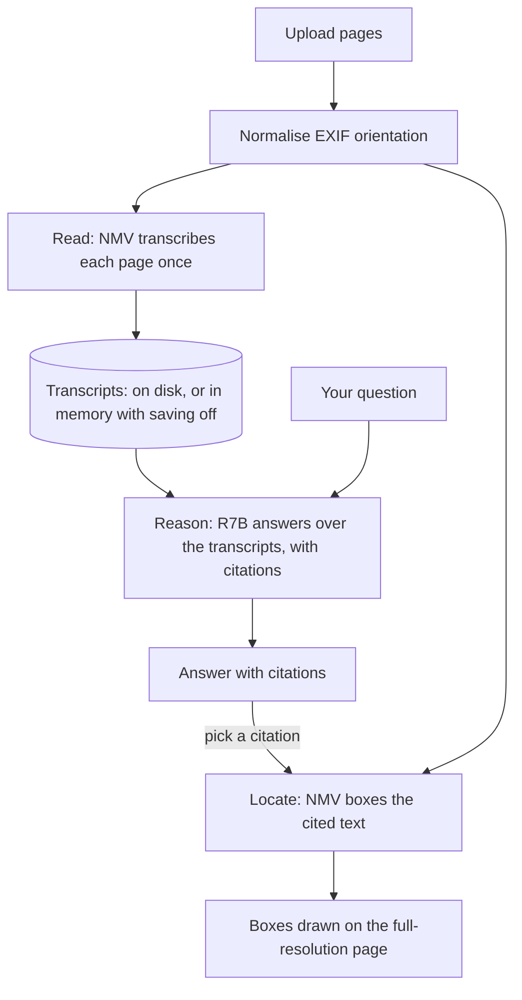
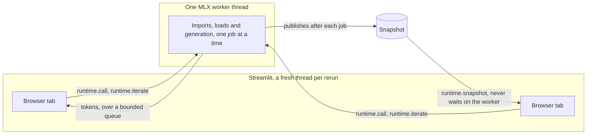

# Architecture

How the app works, and why it is built this way.

## Layout

```text
streamlit_app.py          entry point and router
app_pages/chat.py         multi-turn visual chat
app_pages/grounding.py    detection with box overlay
app_pages/documents.py    Ask documents: transcribe, ask, locate
nmv/runtime.py            the MLX worker thread (read this first)
nmv/model.py              North Micro Vision: loading, sampling, streaming
nmv/reader.py             Command R7B: loading, context budget, streaming
nmv/r7b_format.py         R7B's prompt and output format (no MLX import)
nmv/prompts.py            every fixed prompt and its version
nmv/domain.py             the document pipeline's data model
nmv/documents.py          Ask documents' decisions, kept testable
nmv/citations.py          citation tag parsing
nmv/transcripts.py        the SQLite transcript store
nmv/imaging.py            token budgeting and resizing (no MLX import)
nmv/grounding.py          0–1000 box parsing and rendering
nmv/render.py             makes model output safe to render
nmv/errors.py             sorts exceptions into what the user can do
nmv/trace.py              one run record per action, never content
nmv/log.py                terminal logging, metadata only
nmv/system.py             macOS memory status
nmv/ui.py                 shared sidebar
scripts/                  preflight doctor, memory check, performance pass
evals/                    eval sets, runners, metrics and the baseline
tests/                    plain-script tests in tiers, run by tests/run.py
```

## How Ask documents works

North Micro Vision reads, Command R7B reasons, and North Micro Vision locates. R7B never
sees the image, so a box always comes from a second pass over the page.



**Search saved documents** is the local stand-in for retrieval. It runs an SQLite FTS5
query over the saved transcripts, with every term quoted so FTS5 syntax in it means
nothing, and uses no model and no extra memory. A page added from search joins the
documents as text only, because the store never keeps page images. Its citations are
greyed out with "Re-upload this page to locate it." Uploading the same file (same bytes,
so the same page id) replaces the text-only page with the upload, which brings back the
image and Locate with nothing else to do. Saved pages go through the reader's context
budget like uploads, and any that do not fit are named. Only transcripts from the current
checkpoint, prompt and token limit are offered.

## Token count scales with pixel area

The encoder cuts an image into 16 px patches, merges each 2×2 block, and spends one
language-model token per merged block. One token therefore covers 32×32 px:

```text
tokens = pixels / 1024
```

The **Image budget** slider is the single biggest lever on prefill latency and KV-cache
memory. Its ceiling is 3,868,706 px — 1654×2339, an A4 page at 200 dpi, the largest
resolution Cohere trained on, and mlx-vlm's own default cap. Each edge snaps to a
multiple of 32, and anything above the ceiling is scaled down to fit:

| Input | Encoded | Tokens |
|---|---|---:|
| A4 scan @ 200 dpi (1654×2339) | 1632×2336 | 3,723 |
| 1080p photo (1920×1080) | 1920×1088 | 2,040 |
| 12 MP phone photo (4032×3024) | 2240×1696 | 3,710 |

The checkpoint's `preprocessor_config.json` advertises a far larger `size.longest_edge`
of 16,777,216 px (16,384 tokens — double the 8K context the model was actually validated
at for multimodal input). mlx-vlm never reads it: its processor only honours keys
literally named `min_pixels`/`max_pixels`, which that file lacks. The effective budget is
the sane one.

## Grounding coordinates are resolution independent

Boxes come back as `[x1, y1, x2, y2]` on a **0–1000** grid, not in pixels, so
`x_px = x / 1000 * width` works against whichever rendering you like. That is why the
overlay can be drawn on your full-resolution upload even though the encoder saw a
downscaled copy — nothing has to be rescaled between the two.

Two traps this codebase handles and you should keep handling:

- **EXIF orientation.** Phone photos carry a rotation tag. Normalise it *before*
  encoding, and draw boxes on that same normalised image — otherwise the model reads a
  sideways page while the overlay is upright and every coordinate lands wrong.
- **Bare arrays.** Despite being asked for labelled JSON, the model often replies with a
  plain `[659, 671, 921, 799]`. `nmv/grounding.py` parses JSON, fenced blocks and loose
  prose, and treats labels as optional.

## MLX streams are thread-local — this shapes the whole architecture

MLX binds each thread's default stream to that thread, and an array that has not been
evaluated yet is work queued on one of those streams, so only that thread can evaluate
it. mlx-vlm's `load()` evaluates the model's parameters but not the arrays it keeps under
underscore names, and the text model's shared rotary `_inv_freq` table is one of them: it
stays pending until the first forward pass reads it, so that pass has to run on the
thread that loaded the model.

Streamlit starts **a fresh ScriptRunner thread for each rerun the browser requests**, and
`st.cache_resource` loads the model during the page's first render. So in a naive app the
first reply, and every one after it, dies with:

```text
RuntimeError: There is no Stream(gpu, 1) in current thread.
```

`nmv/runtime.py` fixes this by running the import, the load and every later MLX call on
one long-lived worker thread, streaming tokens back over a bounded queue. It also
serialises GPU work across browser tabs, which matters because MLX generation is not
reentrant.

**The invariant:** mlx-vlm is imported only inside worker functions, never at module
scope, so anything it queues at import time lands on the worker too. `nmv/imaging.py`
therefore mirrors mlx-vlm's `smart_resize` as plain arithmetic instead of importing it;
`tests/test_resize_parity.py` asserts the copy stays identical to upstream.



## The model's own limits

- No system prompts — Cohere notes it was not trained to follow them, so the app never
  sends one. Task instructions go in the user turn.
- Weak text-only reasoning (MMLU 0.504). No tool calling, no agentic workflows, limited
  maths and code.
- 8K context was validated for multimodal input, even though the LM backbone claims 128K.
- Some tables come back as HTML, though the prompt asks for Markdown. Ask documents' Transcript
  redraws plain ones as Markdown for display only, so the stored text and what the reader
  gets stay as the model wrote them. A table with merged cells still shows its tags, and so
  does any table in a Chat reply.

## Accessibility

Boxes drawn on an image say nothing to a screen reader, and colour alone cannot link a
box to its row. So the app gives each one a text equivalent:

- **Every box is described in words,** such as "lower right · about 25% of the page
  wide, 15% tall". Grounding shows this in the table's "where" column, and Ask documents
  in the caption under a located page.
- **Every box is numbered.** `#N` stays on the box and matches the table's `#` column,
  even with "Show label text" off.
- **Stream responses can be turned off** in the sidebar. A reply then appears once,
  complete, with no moving text.
- **Every image has a caption** in place of alt text, which `st.image` does not offer.
- **Every alert says what to do next,** and citations name their page in text.
- **Contrast floors are tested** on both themes by `tests/test_theme_contrast.py`. It
  computes colours from the config, so it is a floor rather than proof of what renders.

Known gaps:

- **The keyboard focus ring is 2.43:1** in both themes, under the 3:1 that WCAG
  recommends. No single config value fixes it without undoing the accent's other
  trades, and the app uses no custom CSS.
- **The dark theme's toggle knob is 2.26:1** on its "on" track. The Transcribe button
  states the save mode in text, so that setting never depends on the knob.
- **Widget ARIA and live regions belong to Streamlit,** so the app cannot change them.

Checked by hand before the release:

- **axe** found no serious or critical issues on any of the three pages.
- **Reflow:** every page works at 320 px and at 200% zoom, with no sideways scroll.
- **VoiceOver** reads a box's position from the table, reads the page caption when a
  citation is opened, and reads a non-streamed answer once, in full.
- **Keyboard only:** upload, transcribe, the save toggle, page pills and the Transcript
  all work, and focus never gets trapped.
